  <h3><code>ubstorm128@github ~ $ ./contributions.sh</code></h3>

  

    

  <h3><code>ubstorm128@github ~ $ whoami</code></h3>

  <table>
    <tr>
      <td valign="top">
        
      </td>
      <td valign="top">
        
      </td>
    </tr>
  </table>

